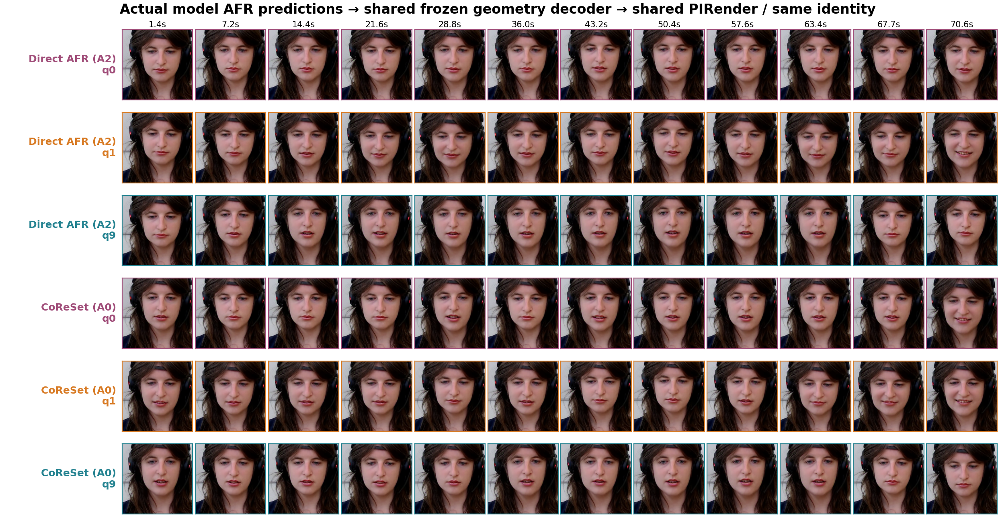
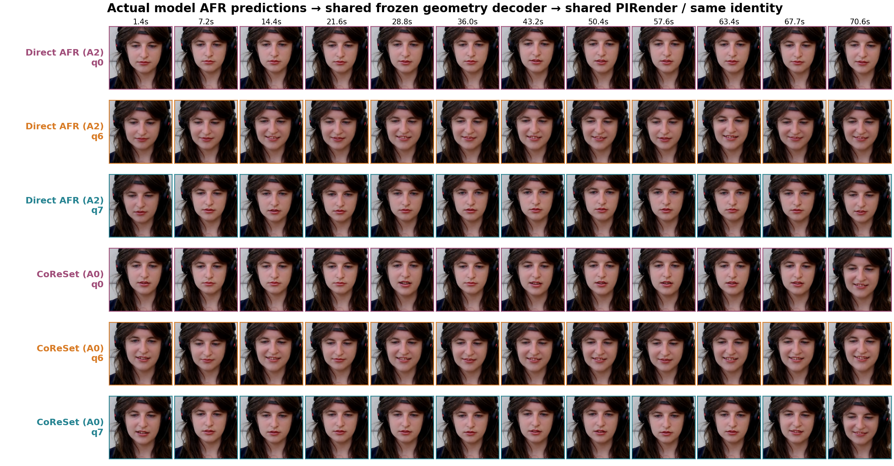

# CoReSet visual materials

Additional figures, editable SVGs, and rendered reaction comparison videos for the supplementary appendix. The existing S1–S6 PNG/PDF exports remain in `../figures/`.

## Comparison videos / 生成反应对比视频

- Standard slots (0, 1, 9): [MP4](videos/standard_slots/a2_coreset_generated_comparison.mp4) · [Contact sheet](previews/standard_slots_contact_sheet.png)
- Diverse slots (0, 6, 7): [MP4](videos/diverse_slots/a2_coreset_generated_comparison.mp4) · [Contact sheet](previews/diverse_slots_contact_sheet.png)
- [Comparison preview](previews/comparison_video_midpoint.png)

The videos visualize actual A2 and CoReSet AFR predictions using a shared identity and frozen rendering pipeline. They are selected illustrations; quantitative conclusions are reported in the Markdown appendix. Rendering provenance and slot-selection metadata are in `metadata/`. The models predict AFR attributes rather than image pixels.

## Figure files / 图件版本

| Figure | Formats |
| --- | --- |
| a2_coreset_clearer_generated_cases | [PDF](figures/a2_coreset_clearer_generated_cases.pdf) · [PNG](figures/a2_coreset_clearer_generated_cases.png) · [SVG](figures/a2_coreset_clearer_generated_cases.svg) |
| a2_coreset_generated_faces | [PDF](figures/a2_coreset_generated_faces.pdf) · [PNG](figures/a2_coreset_generated_faces.png) · [SVG](figures/a2_coreset_generated_faces.svg) |
| a2_coreset_generated_faces_diverse_slots | [PDF](figures/a2_coreset_generated_faces_diverse_slots.pdf) · [PNG](figures/a2_coreset_generated_faces_diverse_slots.png) · [SVG](figures/a2_coreset_generated_faces_diverse_slots.svg) |
| a2_coreset_generated_faces_diverse_slots_sequences | [PDF](figures/a2_coreset_generated_faces_diverse_slots_sequences.pdf) · [PNG](figures/a2_coreset_generated_faces_diverse_slots_sequences.png) |
| a2_coreset_generated_faces_sequences | [PDF](figures/a2_coreset_generated_faces_sequences.pdf) · [PNG](figures/a2_coreset_generated_faces_sequences.png) |
| a2_coreset_generation_comparison | [PDF](figures/a2_coreset_generation_comparison.pdf) · [PNG](figures/a2_coreset_generation_comparison.png) · [SVG](figures/a2_coreset_generation_comparison.svg) |
| a2_coreset_generation_comparison_video_strip | [PDF](figures/a2_coreset_generation_comparison_video_strip.pdf) · [PNG](figures/a2_coreset_generation_comparison_video_strip.png) |
| qualitative_reaction_set | [PDF](figures/qualitative_reaction_set.pdf) · [PNG](figures/qualitative_reaction_set.png) |
| reaction_set_and_difference_transfer | [PDF](figures/reaction_set_and_difference_transfer.pdf) · [PNG](figures/reaction_set_and_difference_transfer.png) · [SVG](figures/reaction_set_and_difference_transfer.svg) |
| real_references_all_matched_outputs | [PDF](figures/real_references_all_matched_outputs.pdf) · [PNG](figures/real_references_all_matched_outputs.png) |
| real_references_for_generated_case | [PDF](figures/real_references_for_generated_case.pdf) · [PNG](figures/real_references_for_generated_case.png) |
| within_set_difference_transfer_compact | [PDF](figures/within_set_difference_transfer_compact.pdf) · [PNG](figures/within_set_difference_transfer_compact.png) · [SVG](figures/within_set_difference_transfer_compact.svg) |

## Preview

## Provenance

[Asset hashes and original workspace paths](manifest.json). Original model outputs and metadata are preserved; the figures and videos have not been re-rendered for this upload.
